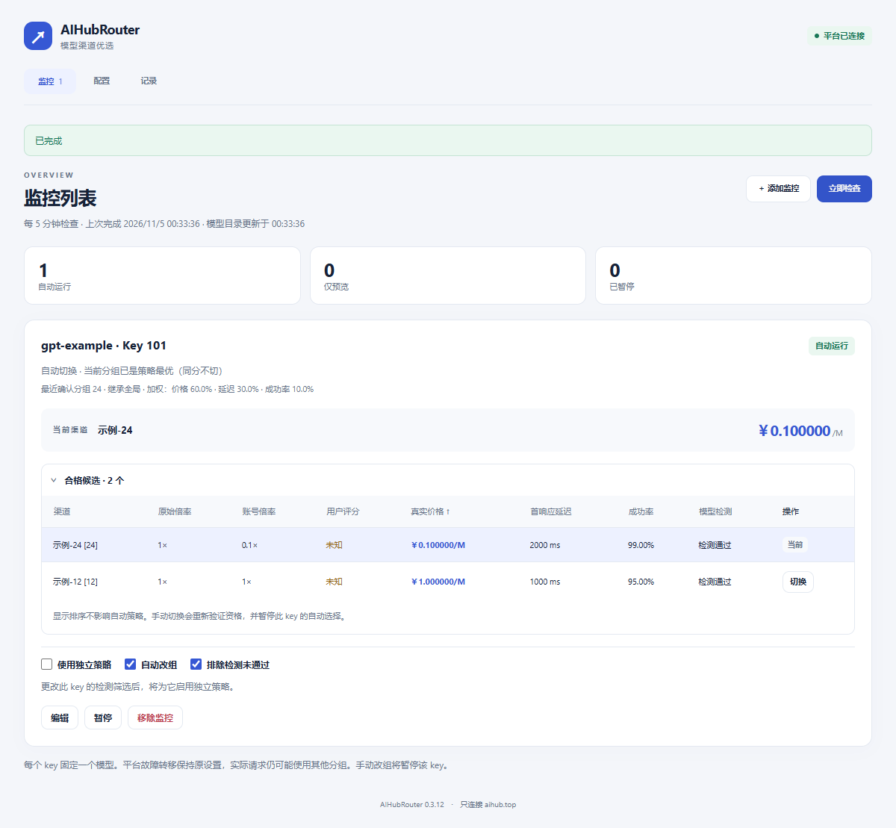
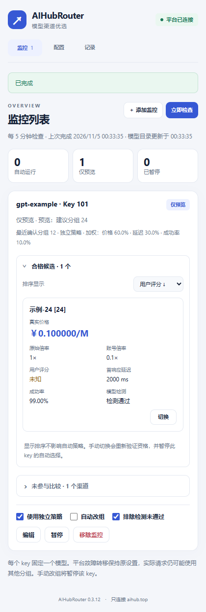
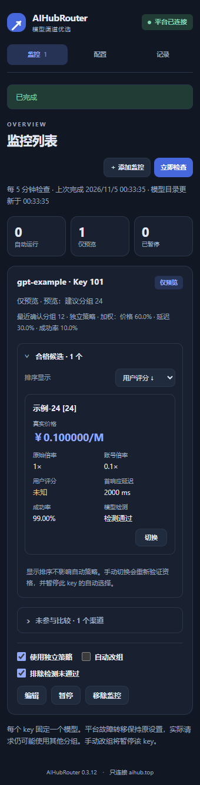
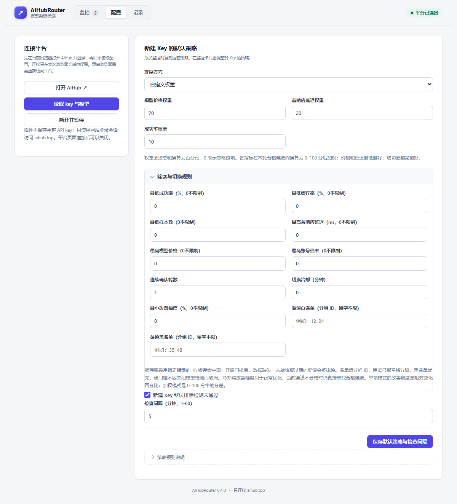

<p align="center">
  
</p>
<h1 align="center">AIHubRouter</h1>
<p align="center"><strong>一个 key，一个模型，自动找到合适的渠道。</strong></p>
<p align="center">为 AIHub 的模型渠道持续比价，在价格、首响应和成功率之间选择你的优先项。</p>
<p align="center">
  <a href="#安装">安装使用</a> ·
  <a href="#界面展示">界面展示</a> ·
  <a href="docs/routing.md">完整规则</a> ·
  <a href="PRIVACY.md">隐私政策</a> ·
  <a href="https://github.com/tibbar213/AIHubRouter/issues">反馈问题</a>
</p>

<p align="center">Chrome / Edge · Manifest V3 · MIT 开源 · 配置保存在本地</p>



> 界面截图来自插件的隔离测试环境，使用模拟 key、渠道与报价，仅用于展示功能。

## 它能做什么

**油猴版已提供：** [安装与使用说明](userscript/README.md) · [可安装脚本](userscript/AIHubRouter.user.js)。在网站内浮窗使用，默认仅预览；需要保留 AIHub 标签页。请勿和扩展版同时自动管理同一个 key。

在 [AIHub](https://aihub.top/providers) 为同一个模型比较不同渠道时，除了价格，还需要核对健康状态、账号权限和 key 的倍率上限。AIHubRouter 把这些检查放到浏览器扩展中，按你设置的策略持续比较，并在允许时调整 key 的首选分组。

| 功能 | 使用方式 |
| --- | --- |
| **每个 key 独立选渠道** | 一个 key 绑定一个完整模型名，多个模型同时监控 |
| **按你的优先项排序** | 真实价格、首响应延迟、成功率，或三项自定义权重 |
| **先预览，再启用自动切换** | 新增监控默认仅预览，检查候选后再打开“自动改组” |
| **全局默认，逐 key 覆盖** | 日常统一省钱，需要时给特定模型设置独立策略 |
| **看清候选再决定** | 对比倍率、用户评分、真实价格、性能和检测结果，也可手动切换 |
| **价格不足时尝试估算** | 数据满足条件时计算估算价格，明确标记估算与样本数 |
| **小窗与侧栏都能用** | 点击图标快速查看，一键切到侧栏；支持窄屏与深色模式 |
| **检查结果有记录** | 浏览器通知与本地操作记录，登录恢复后继续检查 |

支持的模型系列和名称从平台目录读取，包括 OpenAI、Kimi、智谱 GLM、Grok、DeepSeek、Gemini；平台新增目录会随检查更新。

## 界面展示

### 监控总览

打开插件先看运行中的模型：当前渠道、价格、自动运行 / 仅预览 / 已暂停状态一目了然。合格候选默认收起，需要时展开比较；不合格渠道只汇总排除原因与数量。

上方总览图展示了候选表格。显示排序只影响表格顺序，自动选择仍遵循该 key 的实际策略。

### 侧栏与深色模式

窄窗口自动切换为渠道卡片，无需横向拖动表格。深色模式跟随浏览器的颜色偏好。

<table>
  <tr>
    <th width="50%">侧栏 / 小窗中的布局</th>
    <th width="50%">深色模式</th>
  </tr>
  <tr>
    <td valign="top"></td>
    <td valign="top"></td>
  </tr>
</table>

<details>
<summary><strong>展开查看：全局策略与筛选设置</strong></summary>

在“配置”页调整价格、延迟和成功率的权重；还可设置成功率下限、样本数、延迟上限、价格上限、倍率上限、渠道名单、确认轮数和切换冷却。



</details>

## 安装

从 [Releases](https://github.com/tibbar213/AIHubRouter/releases/latest) 下载 `AIHubRouter-版本号-chromium.zip`，Chrome 和 Edge 通用。两个商店版本尚未发布。

1. 下载 Release 安装包并解压。也可[下载源码 ZIP](https://github.com/tibbar213/AIHubRouter/archive/refs/heads/main.zip) 或克隆本仓库。
2. Chrome 打开 `chrome://extensions`，Edge 打开 `edge://extensions`。
3. 开启“开发者模式”，点击“加载已解压的扩展程序”。
4. Release 安装包选择**解压后直接包含 `manifest.json` 的目录**；源码安装则选择仓库中的 **`extension` 文件夹**。
5. 点击插件图标打开小窗；点击“在侧栏打开”可切换到侧栏。

升级已解压扩展时，更新原安装目录，再到扩展管理页点击“重新加载”，以保留原扩展身份与配置。

## 第一次使用

1. **连接平台**：在同一个浏览器登录 [AIHub](https://aihub.top)，打开插件的“配置”页，点击“读取 key 与模型”。
2. **绑定模型**：选择已有 key 和它固定使用的完整模型名，点击“保存 key 配置”。
3. **先看预览**：回到“监控”，点击“立即检查”，展开“合格候选”核对价格和渠道。
4. **开启自动改组**：确认后，打开该监控卡片上的“自动改组”。默认每 5 分钟检查一次。

需要给单个 key 调整策略时，勾选它的“使用独立策略”，点击“编辑”，在配置页调整后保存。“排除检测未通过”也在监控卡片中设置。

## 价格和切换如何判断

- **先筛选，再排序**：绑定模型需要上架、健康且探测有效，渠道需要可用、账号可绑定，并满足设置的限制。
- **渠道检测看整体结果**：默认排除检测未通过的渠道；检测模型可以与绑定模型不同，表格会注明实际检测的模型。
- **真实价格优先，估算明确标记**：平台样本不足时，若对应模型的计算数据完整且有效，可使用估算值参与排序；没有可用样本时不会凭空补价。价格是平台指标口径，不等于某一次请求的完整账单。
- **key 倍率上限单独检查**：这是平台为该 key 设置的允许上限。当前渠道为 0.05×，不会因此排除 0.08×；只有该 key 的上限低于 0.08× 时才会排除。
- **默认一轮确认，同价不切**：没有合格候选时保留当前分组。外部改组后更新记录，本轮不覆盖，下轮继续检查。
- **手动切换有确认**：提交前重新检查资格，切换后暂停该 key 的自动选择。平台内置故障转移可能改变实际请求所用渠道。

更多计分公式、可调范围和切换恢复规则见 [完整规则](docs/routing.md)。

## 隐私与权限

扩展只访问 `https://aihub.top/*`，没有开发者运营的数据接收、广告或分析服务。

- 网站登录令牌保存在扩展会话存储中；不保存密码或刷新令牌。
- 平台响应中的完整 API key 不会写入扩展配置或日志，只保留监控需要的 ID、名称、分组和状态等信息。
- 配置与最多 150 条操作记录保存在当前浏览器的扩展本地存储中。
- “断开并暂停”会清除扩展会话并暂停监控；卸载扩展会移除其本地数据。

详见 [隐私政策](PRIVACY.md)。

## 开发与验证

Node.js 20+、Python 3。扩展本身没有第三方运行依赖。

```bash
npm ci --cache ./work/npm-cache
npm test
npm run check
node scripts/browser-smoke.mjs
npm run package
```

浏览器测试使用 Windows 上的系统 Edge 和隔离配置，通过模拟数据检查连接、策略、候选展示、窄屏、深色模式及切换流程，不操作日常浏览器账号。真实平台改组尚未由维护者实测；自动化通过不代表所有线上行为均已验证。

提交问题时，可附插件版本、浏览器版本、绑定模型和错误文字；请勿上传完整 API key、登录令牌或带凭据的 HAR。

## 许可证

[MIT](LICENSE) · 本项目是独立浏览器扩展，与 AIHub 平台及其教程中的同名 CLI 工具没有代码或发布关系。
